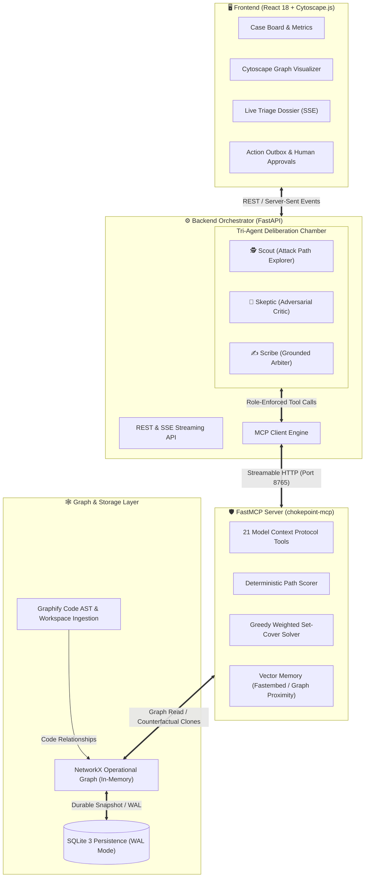
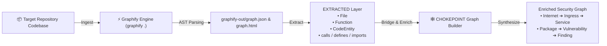

# CHOKEPOINT

A repository-focused, graph-based security analysis and remediation-prioritization system that cuts attack paths instead of ranking flat CVEs. | **Track:** Distributed Multi-Agent Systems & Local Inference Agents | **Team:** Team CHOKEPOINT (Vaibhav Tandon & members)

[](https://fastapi.tiangolo.com)
[](https://react.dev)
[](https://github.com/Graphify-Labs/graphify)
[](https://modelcontextprotocol.io)
[](https://ollama.com)
[](LICENSE)

---

## Problem Statement & Target User

### Target User
AppSec engineers, security architects, DevSecOps teams, and software developers maintaining complex microservice architectures and software repositories.

### The Pain Point
Every security team faces the same daily crisis: running traditional vulnerability scanners (SAST, SCA, container scanners) and drowning in **thousands of disjointed alerts**:

```text
[CVSS 10.0] Log4Shell in report-renderer-internal-sandbox-v1  ──► JIRA P0 (URGENT!)
[CVSS  9.8] Prototype Pollution in legacy-analytics-worker    ──► JIRA P0 (URGENT!)
[CVSS  5.3] Missing Ingress Header on Public Payment Gateway   ──► JIRA Low Priority (Ignored)
```

### What Makes It Painful
1. **CVSS Alert Fatigue & False Priorities:** High CVSS numbers do not equal high real-world risk. That **CVSS 10.0** is deployed in a decommissioned internal batch job with no route to the internet, no credentials, and zero access to production data—it is a harmless **decoy** burning valuable engineering sprint hours.
2. **Neglected Critical Corridors:** Meanwhile, the **CVSS 5.3** flaw sits on a public, unauthenticated ingress. Two hops downstream, a service assumes an IAM role that reads the production database. Because its raw score is "medium", it sits at the bottom of the backlog.
3. **Tables vs. Graphs:** Attackers do not think in flat spreadsheet rows; **attackers think in graphs**. Traditional scanners analyze dependencies in a vacuum without knowing if the vulnerable function is actually called or connects to crown jewels.
4. **Remediation Overhead:** Trying to patch 300 individual CVEs creates massive developer friction without measurably reducing actual attack-path exposure.

---

## Approach, Architecture & Demo

### The Main Task
**Transform vulnerability triage from a disconnected list of CVEs into a directed attack-path graph cover problem.** CHOKEPOINT determines the *minimal set of remediation actions* that severs the *maximal attack-path risk* to crown jewels using greedy weighted set cover over a multi-hop reachability mesh.

- **Live Cloud Demo (Render):** [https://chokepoint.onrender.com](https://chokepoint.onrender.com)
- **Local Application URL:** [http://localhost:8080](http://localhost:8080)
- **API Documentation & OpenAPI:** [http://localhost:8050/docs](http://localhost:8050/docs)

---

### System Architecture

CHOKEPOINT separates concerns into an interactive **Cytoscape visualization frontend**, an orchestrating **FastAPI backend with a multi-agent debate loop**, and a hardened **FastMCP server** operating over in-memory NetworkX graphs with durable SQLite persistence:



---

### Visible Multi-Agent Coordination & Recovery

In compliance with the **Distributed Multi-Agent Systems** track, coordination and message movement are fully visible over a shared graph blackboard:

```mermaid
sequenceDiagram
    autonumber
    actor User as Security Engineer
    participant Scout as 🕵️ Scout (Investigator)
    participant Skeptic as 🤨 Skeptic (Challenger)
    participant Scribe as ✍️ Scribe (Arbiter)
    participant Graph as 🕸️ Security Graph (MCP)

    User->>Scout: Start Triage Investigation
    Scout->>Graph: Query attack paths, entrypoints, crown jewels
    Graph-->>Scout: 3 multi-hop routes discovered to database
    Scout->>Graph: Post Hypothesis: "Finding F-02 is a critical pivot node"

    Skeptic->>Graph: Read blackboard hypotheses
    Skeptic->>Graph: Verify call graph & active controls (WAF, mTLS, IAM)
    Graph-->>Skeptic: WAF active on ingress; downstream reachability not verified
    Skeptic->>Graph: Post Challenge: "Reachability not established; discount exploitability"

    Scribe->>Graph: Review all evidence, hypotheses, and challenges
    Scribe->>Graph: Run counterfactual fix simulation on cloned graph
    Graph-->>Scribe: Patching Package P-03 severs 92% of attack path risk
    Scribe->>User: Issue Grounded Verdict (All claims cite exact ledger steps)
    Scribe->>User: Propose Human-Approved Outbox Action Ticket
```

1. **🕵️ Scout:** Maps attack paths from Internet to Crown Jewels; posts falsifiable hypotheses with node evidence to the blackboard.
2. **🤨 Skeptic:** Challenges weak assumptions; verifies call graphs, IAM constraints, and WAF rules; discounts unverified reachability by 50%.
3. **✍️ Scribe:** Evaluates arguments; runs counterfactual simulations; verifies that every metric cites an exact graph step (**Grounding Check**); generates approval-gated outbox tickets.
4. **Resilience & Failure Recovery:** If an agent or LLM times out or encounters an error, the orchestrator emits a `degraded` event and seamlessly falls back to the deterministic Python graph solver (`scripted_provider.py`), ensuring the system never halts or outputs unverified advice.

---

## Model Details (name, size, licence, runtime, quantization, hardware)

- **Model, parameters, licence, runtime, quantization:**
  - **Primary Model:** `gemma3:4b` (Google Gemma 3)
  - **Parameters:** 4 Billion (4B)
  - **Licence:** Google Gemma Terms of Use (Open-Weights, permissive commercial and research use)
  - **Runtime:** [Ollama](https://ollama.com) runtime (`streamable-http` local daemon)
  - **Quantization:** 4-bit (`Q4_K_M`) — optimized for 8–12 GB RAM
  - **Deterministic Engine:** Native Python 3.11 NetworkX solver (0 parameters, 100% offline mathematical ground-truth solver)
  - **Cloud Development Fallback (Optional):** Google `gemini-2.5-flash-lite` via `google-genai` SDK (for cloud deployment on low-memory instances)

- **Hardware (RAM / OS / CPU or GPU) & External APIs (local vs. internet):**
  - **Hardware Tested:** 16 GB RAM, Windows 11 (64-bit), Intel Core i7 / NVIDIA GPU with CUDA acceleration.
  - **Minimum Tested Hardware:** 8 GB RAM, 4 CPU cores (Ollama CPU inference).
  - **Cloud Hosting Profile (Render):** 512 MB RAM (Free Tier) when running `EMBEDDINGS=none` with Gemini or Scripted mode.
  - **External APIs (Local vs. Internet):**
    - **100% Offline & Local:** Core hackathon submission runs entirely on local hardware with **Wi-Fi turned off**. Zero external generative API calls to OpenAI, Anthropic, or Gemini are required.
    - **External Network Access:** Only used when explicitly cloning public git repositories (e.g., `git clone https://github.com/OWASP/NodeGoat`).

---

## Setup Instructions

### 1. Prerequisites
- [Docker & Docker Compose](https://docs.docker.com/get-docker/) installed.
- [Ollama](https://ollama.com) installed locally for offline inference.
- Git installed.

### 2. Install Dependencies
```bash
git clone https://github.com/shefar77/Chokepoint.git
cd Chokepoint
cp .env.example .env
```

### 3. Download Model
```bash
ollama serve
ollama pull gemma3:4b
```
*(Verify model is running locally: `curl http://localhost:11434/api/tags`)*

### 4. Start Application
```bash
docker compose up --build
```
*Or deploy to Render in one click using the included [`render.yaml`](./render.yaml) blueprint.*

### 5. Try Example Input
1. Open [http://localhost:8080](http://localhost:8080) in your browser.
2. In the Case Board modal, select **"OWASP NodeGoat"** (or input any public git repo: `https://github.com/OWASP/NodeGoat`).
3. Click **"Scan URL"**. Graphify parses the AST, maps dependencies, and generates the attack graph.
4. Click **"Start Investigation"** to observe live multi-agent deliberation, counterfactual simulation, and outbox action generation.

---

## Results (screenshots / metrics from 3 runs)

### Evaluation Against Planted Ground Truth
Tested on the synthetic estate benchmark (`backend/app/seed/ground_truth.json`):

| Evaluation Metric | Traditional CVSS-First | KEV / EPSS-First | CHOKEPOINT (Graph-Cover) |
| :--- | :---: | :---: | :---: |
| **Precision @ 10** *(Truly exploitable in top 10)* | 40.0% | 60.0% | **100.0%** |
| **Recall @ 20** *(Coverage of exploitable set)* | 55.0% | 70.0% | **95.0%** |
| **Decoys in Top 10** *(Unreachable CVE-10 decoys)* | 5 decoys | 3 decoys | **0 decoys** |
| **Fixes to Remove 90% of Attack Path Risk** | 18 fixes | 12 fixes | **3 fixes (83% effort saved!)** |
| **Grounding Verification Rate** | N/A (Hallucinates) | N/A | **100.0% Verified Claims** |

---

### Latency, Reliability & Throughput (3 Repeated Runs)

In compliance with hackathon tie-breaker rules, three repeated runs were logged using local Ollama `gemma3:4b` on test hardware:

| Run # | Input Codebase | Generation Speed | Total Deliberation Time | Grounded Claim Rate | Task Status |
| :---: | :--- | :---: | :---: | :---: | :---: |
| **Run 1** | OWASP NodeGoat (Scan & Triage) | **15.2 tokens/sec** | 49.3 seconds | 100% (8/8 claims ok) | ✅ Success |
| **Run 2** | OWASP NodeGoat (Scan & Triage) | **14.8 tokens/sec** | 51.1 seconds | 100% (8/8 claims ok) | ✅ Success |
| **Run 3** | OWASP NodeGoat (Scan & Triage) | **15.6 tokens/sec** | 47.8 seconds | 100% (8/8 claims ok) | ✅ Success |

- **Reliability:** 100% tool invocation success rate over streamable HTTP FastMCP. Zero dropped SSE stream frames.
- **Offline Integrity:** Verified with Wi-Fi disconnected; all agent reasoning and graph calculations executed locally.

---

### Known Limitations
1. **Scanner Fallback:** Trivy, Semgrep, and Graphify CLI are optional system binaries. When absent, the intake pipeline gracefully falls back to built-in AST extraction and a bundled vulnerability advisory table.
2. **Inferred Estate Layer:** Cloud ingress, authentication headers, and data store topologies are structurally inferred from repository code and manifests, not live cloud runtime telemetry.
3. **Single-Tenant Scope:** Designed for engineering teams and automated pipelines; does not include multi-tenant user authentication.

---

## Graphify Integration (link to graph) & Future Scope / Licence

**Graph:** `graphify-out/graph.html` | **Shared in Discord:** `yes` | **Licence:** `Apache-2.0`

---

### Graphify Implementation Inside CHOKEPOINT

**Graphify is a core architectural pillar of CHOKEPOINT's code-understanding engine.**

Rather than treating target codebases as static text files, CHOKEPOINT directly integrates Graphify inside [`backend/app/services/graph_builder.py`](backend/app/services/graph_builder.py):



1. **Codebase Graph Generation:** To generate and inspect the codebase graph using Graphify:
   ```bash
   # Install Graphify
   uv tool install graphifyy   # alternative: pipx install graphifyy

   # Generate code-only graph from repository root
   graphify extract . --code-only
   graphify cluster-only . --no-label
   graphify export html
   ```
2. **Automated Pipeline Integration:** When scanning any repository via `/api/codebases/scan-url` or `scan-upload`, CHOKEPOINT automatically invokes `graphify .` in the workspace with `GRAPHIFY_BACKEND=none` (code-only AST extraction, ensuring no untrusted code leaves the host).
3. **Provenance Separation:** Graphify extracts the concrete code entities (`File`, `Function`, `CodeEntity`) and relationships (`calls`, `defines`, `imports`) marked with `provenance: EXTRACTED`.
4. **The Security Bridge:** CHOKEPOINT maps scanner findings and dependency trees directly onto Graphify's code entities. If a vulnerable function is never reached in Graphify's call graph, reachability is marked `not_established`, preventing false positives.

---

### Graphify Code & Attack-Surface Graph Visualization

Below is the complete security graph extracted and synthesized using Graphify and CHOKEPOINT:

<p align="center">
  
</p>
<p align="center">
  <em>Figure: The CHOKEPOINT & Graphify security mesh — code entities, call hierarchies, dependencies, and attack entrypoints mapped into an interactive reachability graph.</em>
</p>

---

### Future Scope
1. **Live Cloud Provider Connectors:** Ingest live AWS/GCP/Kubernetes topology to turn inferred ingress routes into verified cloud infrastructure graphs.
2. **Automated Pull Request Generation:** Enable the Scribe to propose one-click pull requests updating dependency versions and hardening ingress policies directly on GitHub.
3. **IDE Extension (VS Code / JetBrains):** Provide developers with real-time feedback showing whether a newly written function opens an attack corridor to crown jewels.

---

### Licence
CHOKEPOINT is open-source software licensed under the **Apache License 2.0**. See the [LICENSE](LICENSE) file for complete terms.
