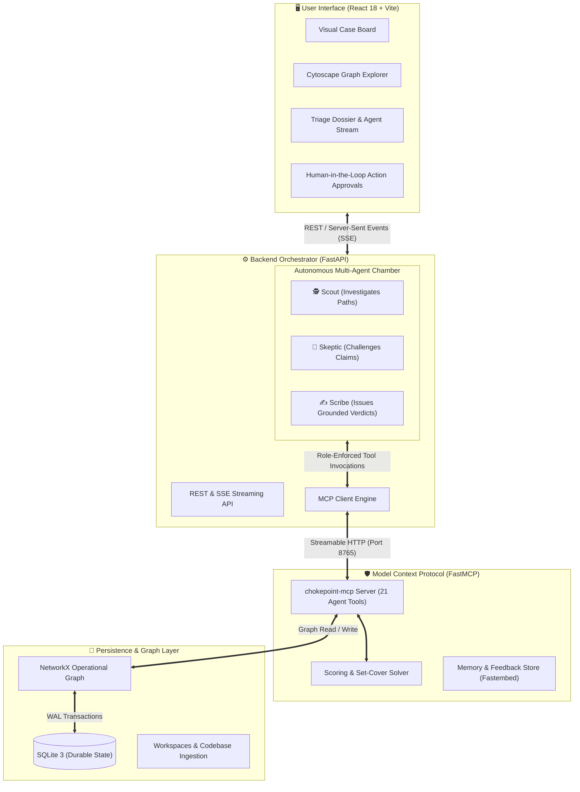
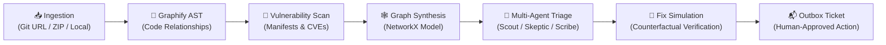

<div align="center">

# ⚡ CHOKEPOINT

### *Stop ranking vulnerabilities. Start cutting attack paths.*

[](https://fastapi.tiangolo.com)
[](https://react.dev)
[](https://js.cytoscape.org)
[](https://networkx.org)
[](https://modelcontextprotocol.io)
[](https://www.docker.com)
[](https://render.com)
[](LICENSE)

<br />

<p align="center">
  
</p>

*The CHOKEPOINT Security Graph: Code entities, call graphs, entry points, and vulnerable packages mapped into a multi-hop reachability mesh.*

<br />

</div>

---

## 💡 The Human Problem: Why Vulnerability Tables Fail

Every security engineer and developer knows the feeling of staring down a scanner report with **3,412 open vulnerabilities**. 

```text
[CVSS 10.0] Log4j in report-renderer-internal-sandbox-v1  ──► JIRA TICKET #4921 (P0 URGENT!)
[CVSS  9.8] Prototype Pollution in legacy-analytics-job   ──► JIRA TICKET #4922 (P0 URGENT!)
[CVSS  5.3] Missing Header on Public Payment Ingress      ──► JIRA TICKET #4923 (Low Priority)
```

**Here is the reality:**
- That **CVSS 10.0** is deployed in a decommissioned internal batch job that has no inbound route, cannot access the internet, and holds zero credentials. It is a complete decoy.
- Meanwhile, the **CVSS 5.3** sits directly on an internet-facing ingress route. Two hops later, an unauthenticated service assumes an IAM role that can read the production database.

Traditional vulnerability scanners look at dependencies in isolation. But **attackers do not think in lists; attackers think in graphs.** 

**CHOKEPOINT flips the equation.** Instead of asking *"Which vulnerability has the highest CVSS number?"*, CHOKEPOINT asks:

> **"What is the absolute smallest set of fixes that sever the maximum amount of verified attack-path risk to our crown jewels?"**

---

## 🎯 How CHOKEPOINT Works at a Glance

| Feature | The Old Way (Flat Lists) | The CHOKEPOINT Way (Graph-Cover Triage) |
| :--- | :--- | :--- |
| **Context** | Single file or package in a vacuum | Multi-hop path: `Internet ➔ Ingress ➔ Service ➔ IAM Role ➔ Database` |
| **Reachability** | Assumed exploitable because it exists | Proven reachability: Checks if vulnerable functions are actually invoked |
| **Prioritization** | Sort by CVSS score descending | Greedy **Weighted Set Cover** over all viable attack paths |
| **Agent Reasoning** | Single prompt with unverified output | **Tri-Agent Debate** (Scout vs. Skeptic vs. Scribe) via Model Context Protocol |
| **Hallucination Protection** | None (LLMs guess numbers) | **Grounding verification**: Every claim must cite an exact graph query step |
| **Remediation** | Open 500 individual patch tickets | **Counterfactual simulation**: Test patches on graph clones before acting |

---

## 🏛️ System Architecture

CHOKEPOINT separates concerns into three distinct layers: an interactive **Cytoscape visualization frontend**, an orchestrating **FastAPI backend with a multi-agent debate loop**, and a hardened **FastMCP server** operating over in-memory NetworkX graphs with durable SQLite persistence.



### The Two Sacred Invariants:
1. **Agents never touch the database directly:** Every single action goes through the FastMCP server, where strict role-based permission boundaries are validated.
2. **The LLM never calculates risk scores:** Models reason, argue, and synthesize. Numerical risk formulas and greedy set-cover algorithms run inside deterministic Python algorithms (`mcp_server/scoring.py` and `mcp_server/solver.py`).

---

## 🤖 The Tri-Agent Deliberation Loop

Rather than relying on a single prompt that easily hallucinates risk, CHOKEPOINT runs a three-party courtroom debate on a shared graph blackboard:

```mermaid
sequenceDiagram
    autonumber
    actor User as Security Engineer
    participant Scout as 🕵️ Scout (Investigator)
    participant Skeptic as 🤨 Skeptic (Challenger)
    participant Scribe as ✍️ Scribe (Arbiter)
    participant Graph as 🕸️ Security Graph (MCP)

    User->>Scout: Start Triage Investigation
    Scout->>Graph: Query attack paths, entrypoints, crown jewels
    Graph-->>Scout: 3 reachable paths found to database
    Scout->>Graph: Post Hypothesis: "Finding F-01 is a critical pivot"
    
    Skeptic->>Graph: Read blackboard hypotheses
    Skeptic->>Graph: Probe reachability & check active controls (WAF, mTLS)
    Graph-->>Skeptic: WAF rule protects route; function call is unmapped
    Skeptic->>Graph: Post Challenge: "Reachability not established; mitigation active"

    Scribe->>Graph: Review all evidence, hypotheses & challenges
    Scribe->>Graph: Run counterfactual simulation for candidate chokepoints
    Graph-->>Scribe: Patching Package P-02 cuts 92% of attack paths
    Scribe->>User: Issue Grounded Verdict (Citing exact ledger steps)
    Scribe->>User: Propose Human-Approved Action Ticket
```

### 1. 🕵️ The Scout (Attack Path Explorer)
* **Role:** Seeks paths from `Internet` to `Crown Jewels` (databases, secret stores, admin interfaces).
* **Behavior:** Identifies critical bridges, lateral movement corridors, and posts falsifiable hypotheses to the blackboard.

### 2. 🤨 The Skeptic (Adversarial Critic)
* **Role:** Attempts to dismantle the Scout's theories.
* **Behavior:** Checks whether reachability was verified or merely assumed. Flags mitigating controls (WAFs, IAM policies, network isolation) and discounts unverified findings by 50%.

### 3. ✍️ The Scribe (Arbiter & Grounding Verifier)
* **Role:** Evaluates the arguments, runs counterfactual simulations, and delivers actionable verdicts.
* **Behavior:** Enforces the **Grounding Check**: every number and claim cited must match a verified step recorded in the investigation ledger. If a hallucinated metric is detected, the claim is flagged as failed.

---

## ⚡ The Mathematics of a "Chokepoint"

How does CHOKEPOINT determine which fix comes first?

```text
               ┌──► [Vulnerability A] ──► [Service 1] ──┐
[Internet] ────┼──► [Vulnerability B] ──► [Service 2] ──┼──► [Database]
               └──► [Vulnerability C] ──► [Service 3] ──┘
                                ▲
                                │
                    CHOKEPOINT: Hardening Service 2
                    or patching the shared library
                    breaks all intersecting paths!
```

1. **Path Scoring:** Each attack path is evaluated deterministically:
   $$\text{Score} = \text{Exploitability} \times \text{Exposure} \times \text{Impact} \times \text{Length Penalty} \times \text{Control Discount}$$
   - **Exploitability:** Blends EPSS, CVSS/10, and CISA KEV presence.
   - **Exposure:** Ingress authentication requirements (`None = 1.0`, `Basic = 0.6`, `OIDC = 0.35`).
   - **Impact:** Target data classification and logged record volumes.
   - **Length Penalty:** Paths with more lateral hops are penalized ($0.92^{\text{hops}-3}$).
2. **Greedy Set Cover:** The solver repeatedly picks the single remediation action (e.g., package upgrade, network rule, dependency isolation) that eliminates the largest volume of weighted attack path score.
3. **Counterfactual Simulation:** The fix is executed on a deep in-memory copy of the NetworkX graph. Before-and-after metrics are compared to prove risk reduction before any developer ticket is created.

---

## 🚀 Quick Start

### Prerequisites
- [Docker](https://docs.docker.com/get-docker/) & Docker Compose
- *(Optional)* [Ollama](https://ollama.com/) locally for zero-cost offline LLM inference, or a free [Google Gemini API Key](https://aistudio.google.com/apikey).

### 1. Clone & Configure

```bash
git clone https://github.com/shefar77/Chokepoint.git
cd Chokepoint

# Create environment configuration
cp .env.example .env
```

### 2. Configure Your LLM Mode in `.env`

You have three flexible choices for running agents:

| Mode | Configuration | Best For |
| :--- | :--- | :--- |
| **Local Ollama (Default)** | `AGENT_MODE=live`<br>`OLLAMA_BASE_URL=http://ollama:11434`<br>`OLLAMA_MODEL=gemma3:4b` | Complete offline privacy with zero external API calls. |
| **Google Gemini (Cloud)** | `AGENT_MODE=live`<br>`GEMINI_API_KEY=AIzaSy...`<br>`GEMINI_MODEL=gemini-2.5-flash-lite` | Ultra-fast inference without needing local GPU/RAM. |
| **Deterministic Scripted** | `AGENT_MODE=scripted` | CI/CD pipelines, demos, or systems with no LLMs. Runs real graph tools deterministically! |

### 3. Launch with Docker Compose

```bash
docker compose up --build
```

Open your browser and navigate to:
- **Web UI:** [http://localhost:8080](http://localhost:8080)
- **FastAPI Documentation:** [http://localhost:8050/docs](http://localhost:8050/docs)
- **API Health Check:** [http://localhost:8050/api/health](http://localhost:8050/api/health)
- **FastMCP Server:** [http://localhost:8765/mcp](http://localhost:8765/mcp)

---

## ☁️ Deploying to Render in 5 Minutes

CHOKEPOINT is pre-configured for seamless deployment to [Render](https://render.com) using a production multi-stage container:

[](https://render.com)

### 1-Click Blueprint Deployment
1. Push your repository to GitHub.
2. In the [Render Dashboard](https://dashboard.render.com), click **New +** ➔ **Blueprint**.
3. Select your repository and choose branch `dev` (or `main`).
4. Render will automatically detect [`render.yaml`](./render.yaml).
5. Enter your `GEMINI_API_KEY` (or leave blank to use `AGENT_MODE=scripted`).
6. Click **Apply**.

> [!TIP]
> **Free Tier RAM Optimization:**
> Set `EMBEDDINGS=none` in your Render Environment Variables to fit within Render's free 512MB RAM tier without memory pressure.

---

## 🔍 The Product Workflow: Scanning a Repository

CHOKEPOINT is designed to analyze real repositories straight from Git:



### 1. Ingest a Repository
In the Case Board modal or via `cURL`:
```bash
# Scan a public Git repo directly:
curl -fsS -X POST http://localhost:8050/api/codebases/scan-url \
  -H 'Content-Type: application/json' \
  -d '{"url":"https://github.com/OWASP/NodeGoat","name":"nodegoat"}'
```

### 2. Explore the Attack Surface
- **Cytoscape Graph View:** Inspect interactive nodes representing files, functions, packages, vulnerabilities, and ingress routes.
- **Provenance Transparency:** Nodes clearly indicate whether they were `EXTRACTED` directly from code via Graphify or `INFERRED` via topology heuristics.

### 3. Run Tri-Agent Triage
Click **"Start Investigation"** on the triage board to watch live SSE reasoning stream:
- View hypotheses posted by the Scout.
- Watch the Skeptic dispute weak reachability claims.
- Read grounded verdicts authored by the Scribe.

### 4. Simulate Remediation & Approve Action
- View the simulated graph before and after applying the recommended fix.
- Approve the action to write a formal Markdown & JSON remediation ticket to `/data/outbox`. **Nothing leaves your machine without human approval.**

---

## 🛠️ The 21 MCP Security Graph Tools

The FastMCP server exposes 21 purpose-built tools that agents leverage during investigations:

| Group | Tool Name | Permitted Roles | Purpose |
| :--- | :--- | :--- | :--- |
| **Read** | `graph_overview` | All | High-level graph counts, ingress entrypoints, and crown jewels. |
| **Read** | `find_entities` | All | Resolve free-text queries to specific node IDs. |
| **Read** | `get_service_context` | Scout, Skeptic, Scribe | Full topology for a service: owners, ingress, data stores, calls, findings. |
| **Read** | `list_open_findings` | Scout, Skeptic | The naive CVSS-sorted queue of open vulnerabilities. |
| **Read** | `owner_of` | Scout, Skeptic, Scribe | Resolve team, Slack channel, and on-call engineer for an asset. |
| **Analysis**| `find_attack_paths` | Scout, Skeptic | Trace paths from public ingress to crown jewels with full score decomposition. |
| **Analysis**| `blast_radius` | Scout, Skeptic, Scribe | Measure lateral movement exposure from a compromised node. |
| **Analysis**| `check_exploitability`| Scout, Skeptic | Evaluate boolean live-exploit predicates (network vector, auth, active controls). |
| **Analysis**| `rank_centrality` | Scout, Skeptic | Compute Betweenness or PageRank to find structural bottlenecks. |
| **Analysis**| `find_chokepoints` | All | Execute greedy weighted set cover over active attack paths. |
| **Analysis**| `simulate_fix` | Scout, Skeptic | Apply counterfactual modifications to an in-memory graph copy. |
| **Analysis**| `connected_components`| Scout, Skeptic | Find weakly connected components to identify network partitions. |
| **Analysis**| `shortest_path` | Scout, Skeptic | Fast path existence proof (or counterproof of unreachability). |
| **Memory** | `recall` | All | Retrieve historical lessons and past verdicts by graph proximity and vector search. |
| **Memory** | `diff_since_last` | Scout, Skeptic | Discover what changed in the graph since the previous investigation run. |
| **Blackboard**| `post_hypothesis` | Scout | Publish a falsifiable security theory with cited node evidence. |
| **Blackboard**| `post_challenge` | Skeptic | Challenge an active hypothesis with counter-evidence. |
| **Blackboard**| `list_blackboard` | All | Inspect all current hypotheses and challenges. |
| **Action** | `record_verdict` | Scribe | Commit an official finding verdict backed by grounding verification. |
| **Action** | `propose_action` | Scribe | Generate a human-approved remediation ticket routed to asset owners. |
| **Action** | `record_lesson` | Backend only | Convert engineer overrides and feedback into durable graph memory nodes. |

---

## 🧠 Continuous Learning & Graph-Proximity Memory

When an engineer overrides an agent's verdict (e.g., *"This endpoint is behind a proprietary corporate proxy not modelled in code"*), CHOKEPOINT doesn't discard that human feedback:

1. **Distillation:** The feedback is distilled into a concise lesson node (`Lesson`).
2. **Graph Attachment:** The lesson is linked directly to the specific `Service`, `Package`, or `Vulnerability` node using an `APPLIES_TO` edge.
3. **Proximity Recall:** In future investigations, the `recall` tool searches within a 2-hop radius of the investigated service. The agent automatically receives the engineer's past lesson and adjusts its reasoning accordingly.

---

## 📁 Repository Structure

```text
Chokepoint/
├── backend/
│   ├── app/                      # FastAPI core application
│   │   ├── actions/              # Outbox ticket generation and routing
│   │   ├── orchestrator/         # Tri-agent loop, prompts, and providers (Ollama/Gemini/Scripted)
│   │   ├── repositories/         # SQLite persistence interfaces
│   │   ├── routers/              # REST & SSE endpoints (/api/*)
│   │   ├── services/             # Codebase ingestion, Graphify intake, scanners
│   │   ├── db.py                 # SQLite WAL connection manager
│   │   └── main.py               # Application entrypoint & lifespan
│   ├── mcp_server/               # FastMCP server ("chokepoint-mcp")
│   │   ├── tools/                # 21 MCP tool definitions (read, analysis, memory, etc.)
│   │   ├── scoring.py            # Deterministic path scoring engine
│   │   ├── solver.py             # Greedy weighted set-cover solver
│   │   └── server.py             # FastMCP streamable-HTTP entrypoint
│   └── tests/                    # Comprehensive pytest suite
├── frontend/
│   ├── src/
│   │   ├── features/             # Case Board, Dossier, Explorer, Memory, Evals
│   │   ├── graph/                # Cytoscape visualizer, layout engines, and styling
│   │   └── api/                  # Typed fetch client & EventSource SSE subscriber
│   ├── nginx.conf                # Production reverse proxy config (SSE buffering disabled)
│   └── vite.config.ts            # Vite configuration
├── docker-compose.yml            # Local multi-service composition
├── Dockerfile.render             # Production unified container for Render
├── render-entrypoint.sh          # Container startup & process supervisor
└── render.yaml                   # 1-Click Render Blueprint specification
```

---

## 🧪 Testing & Verification

Run the comprehensive offline test suite (requires no network, no LLMs, and no scanners):

```bash
# Run pytest across the backend
cd backend
python -m pytest tests -q
```

The test suite validates:
- Graph construction and provenance tracking (`EXTRACTED` vs `INFERRED`).
- Exact scoring boundary calculations and mathematical reproducibility.
- Counterfactual graph simulation isolation (ensuring base graph remains untouched).
- Grounding verification (rejecting hallucinated metric citations).
- MCP role permission allow-lists.

---

## ⚖️ License

CHOKEPOINT is open-source software licensed under the **Apache License 2.0**. See the [LICENSE](LICENSE) file for details.
