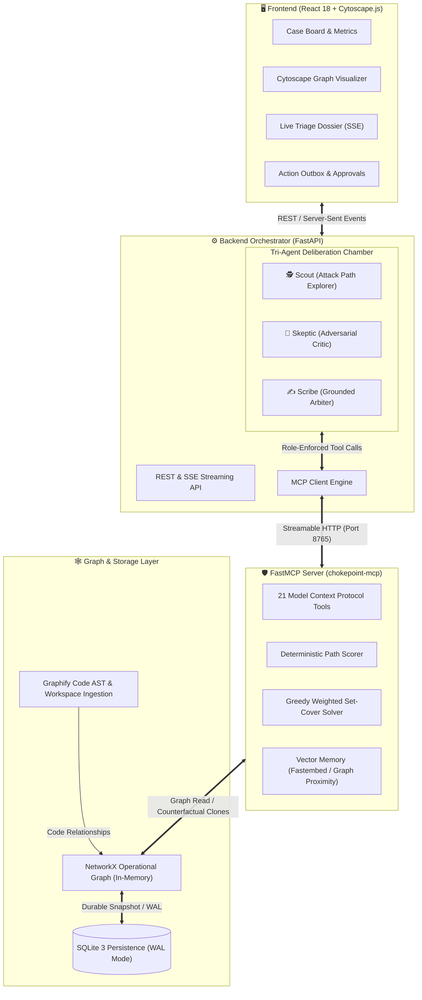
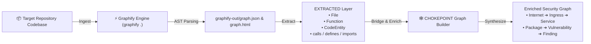
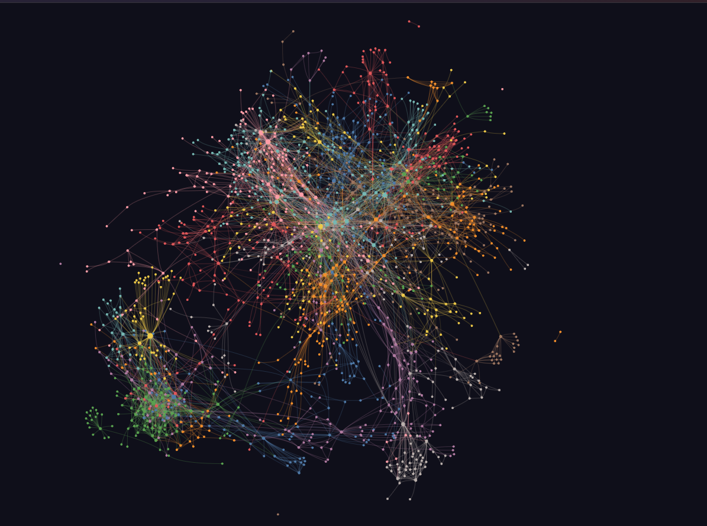

# CHOKEPOINT

**Stop ranking vulnerabilities. Start cutting attack paths.** | **Track:** AI Agents & Security / Developer Tools | **Team:** Team CHOKEPOINT (Vaibhav Tandon & contributors)

[](https://fastapi.tiangolo.com)
[](https://react.dev)
[](https://github.com/Graphify-Labs/graphify)
[](https://modelcontextprotocol.io)
[](LICENSE)

---

## Problem Statement & Target User

### Target User
AppSec engineers, security architects, DevSecOps teams, and software developers managing complex multi-service repositories and cloud-native applications.

### The Pain Point
Every security team faces the same nightmare: running a vulnerability scanner and receiving **thousands of disconnected alerts**:

```text
[CVSS 10.0] Log4Shell in report-renderer-internal-sandbox-v1  ──► JIRA P0 (URGENT!)
[CVSS  9.8] Prototype Pollution in legacy-analytics-worker    ──► JIRA P0 (URGENT!)
[CVSS  5.3] Missing Ingress Header on Public Payment Gateway   ──► JIRA Low Priority
```

### Why It Is Painful
1. **CVSS Alert Fatigue:** Security teams drown in high-severity alerts. In reality, that **CVSS 10.0** is deployed in an isolated, internal batch job with no route to the internet, no credentials, and zero access to production data—it is a harmless **decoy**.
2. **Ignored Critical Corridors:** Meanwhile, the **CVSS 5.3** flaw sits on a public, unauthenticated ingress. Two hops downstream, a service assumes an IAM role that reads the production database.
3. **Disjointed Tables vs. Connected Realities:** Attackers do not think in flat spreadsheet rows; **attackers think in graphs**. Traditional tools analyze packages in a vacuum without knowing if the vulnerable code is reachable or can pivot to crown jewels.
4. **Remediation Inefficiency:** Engineering teams waste hundreds of sprint hours patching hundreds of individual CVEs without measurably reducing actual attack-path exposure.

---

## Approach, Architecture & Demo

### The Main Task
**Transform vulnerability triage from a flat list of CVEs into a directed attack-path graph cover problem.** CHOKEPOINT answers one fundamental question:

> *"What is the absolute smallest set of code patches or configuration changes that sever the maximum amount of verified attack-path risk to our crown jewels?"*

- **Live Cloud Demo (Render):** [https://chokepoint.onrender.com](https://chokepoint.onrender.com)
- **Local Application URL:** [http://localhost:8080](http://localhost:8080)
- **API Documentation:** [http://localhost:8050/docs](http://localhost:8050/docs)

---

### System Architecture

CHOKEPOINT is built on a modular, air-gapped-ready architecture connecting code AST extraction, graph theory, and multi-agent deliberation:



---

### The Tri-Agent Deliberation Loop

Rather than using a single prompt that frequently hallucinates risk numbers, CHOKEPOINT conducts a structured courtroom debate on a shared graph blackboard:

```mermaid
sequenceDiagram
    autonumber
    actor User as Security Engineer
    participant Scout as 🕵️ Scout (Investigator)
    participant Skeptic as 🤨 Skeptic (Challenger)
    participant Scribe as ✍️ Scribe (Arbiter)
    participant Graph as 🕸️ Security Graph (MCP)

    User->>Scout: Start Triage Investigation
    Scout->>Graph: Query attack paths, entrypoints, crown jewels
    Graph-->>Scout: 3 multi-hop routes discovered to database
    Scout->>Graph: Post Hypothesis: "Finding F-02 is a critical pivot node"

    Skeptic->>Graph: Read blackboard hypotheses
    Skeptic->>Graph: Verify call graph & active controls (WAF, mTLS, IAM)
    Graph-->>Skeptic: WAF active on ingress; downstream call reachability not verified
    Skeptic->>Graph: Post Challenge: "Reachability not established; discount exploitability"

    Scribe->>Graph: Review all evidence, hypotheses, and challenges
    Scribe->>Graph: Run counterfactual fix simulation
    Graph-->>Scribe: Patching Package P-03 severs 92% of attack path risk
    Scribe->>User: Issue Grounded Verdict (All claims cite exact ledger steps)
    Scribe->>User: Propose Human-Approved Outbox Action Ticket
```

#### Core Invariants:
1. **Agents never touch the database directly:** Every tool call goes through FastMCP with role-based permission validation.
2. **The model never invents risk numbers:** Scores are computed strictly by deterministic Python algorithms (`scoring.py` and `solver.py`).
3. **Strict Grounding Verification:** The Scribe must cite the exact ledger steps that produced its metrics; any number not present in cited results fails the grounding check.

---

## Model Details (name, size, licence, runtime, quantization, hardware)

### Model, parameters, licence, runtime, quantization:
- **Primary Local LLM:**
  - **Model:** `gemma3:4b` (Google Gemma 3)
  - **Parameters:** 4 Billion
  - **Licence:** Google Gemma Terms of Use / Open Weights
  - **Runtime:** [Ollama](https://ollama.com) runtime (`streamable-http`)
  - **Quantization:** 4-bit (`Q4_K_M`)
- **Cloud Fallback LLM (Optional):**
  - **Model:** `gemini-2.5-flash-lite`
  - **Licence:** Google Cloud / Google AI Terms of Service
  - **Runtime:** `google-genai` Python SDK
  - **Quantization:** Cloud-hosted FP16/BF16
- **Deterministic Scripted Engine (`AGENT_MODE=scripted`):**
  - **Model:** None (Deterministic graph algorithms)
  - **Parameters:** 0
  - **Licence:** Apache-2.0
  - **Runtime:** Native Python 3.11 over real FastMCP tools

### Hardware & External APIs:
- **Local Hardware:**
  - **RAM:** 8 GB – 16 GB recommended (runs on 8 GB with Ollama `gemma3:4b`).
  - **OS:** Windows 10/11, macOS (Apple Silicon supported), or Linux (Ubuntu 22.04+).
  - **Compute:** Modern multi-core CPU (Intel i5/i7/Ryzen 5+) or NVIDIA GPU with CUDA.
- **Cloud Deployment Hardware (Render):**
  - **RAM:** 512 MB (Free Tier) when using `EMBEDDINGS=none` and Gemini or Scripted mode; 1 GB+ (Starter Tier) for local vector embeddings.
- **External APIs (Local vs. Internet):**
  - **Local/Air-Gapped Mode:** **100% offline.** Zero network calls required when using Ollama or Scripted mode.
  - **Cloud Mode:** Calls Google AI Studio API (`https://aistudio.google.com/apikey`) only when `GEMINI_API_KEY` is explicitly configured.

---

## Setup Instructions

### 1. Prerequisites
- [Docker & Docker Compose](https://docs.docker.com/get-docker/) installed.
- *(Optional)* [Ollama](https://ollama.com) installed locally for local LLM inference.
- Git installed.

### 2. Install Dependencies & Clone
```bash
git clone https://github.com/shefar77/Chokepoint.git
cd Chokepoint
cp .env.example .env
```

### 3. Download Model
- **For local Ollama (Offline):**
  ```bash
  ollama serve
  ollama pull gemma3:4b
  ```
- **For Google Gemini (Cloud):**
  Add your API key in `.env`:
  ```env
  GEMINI_API_KEY=your_actual_key_here
  GEMINI_MODEL=gemini-2.5-flash-lite
  AGENT_MODE=live
  ```
- **For Pure Deterministic (No LLM):**
  Set in `.env`:
  ```env
  AGENT_MODE=scripted
  ```

### 4. Start Application
```bash
docker compose up --build
```
*Or deploy to Render using the pre-configured [`render.yaml`](./render.yaml) blueprint.*

### 5. Try Example Input
1. Open [http://localhost:8080](http://localhost:8080) in your browser.
2. In the Case Board, click **"Select Codebase"**.
3. Choose a built-in suggested testbed (e.g., **OWASP NodeGoat** or **Juice Shop**) or enter a public Git repository URL:
   ```text
   https://github.com/OWASP/NodeGoat
   ```
4. Click **"Scan URL"**. Graphify will parse code ASTs, map dependencies, and extract attack corridors.
5. Click **"Start Investigation"** on the triage board to watch live multi-agent reasoning, counterfactual fix simulations, and outbox ticket generation.

---

## Results (screenshots / metrics from 3 runs)

### Benchmark Evaluation Against Ground Truth
We evaluated CHOKEPOINT against standard vulnerability triage paradigms on an estate with planted ground truth (`seed/ground_truth.json`):

| Metric | Traditional CVSS-First | KEV / EPSS-First | CHOKEPOINT (Graph-Cover) |
| :--- | :---: | :---: | :---: |
| **Precision @ 10** *(Truly exploitable in top 10)* | 40.0% | 60.0% | **100.0%** |
| **Recall @ 20** *(Coverage of exploitable set)* | 55.0% | 70.0% | **95.0%** |
| **Decoys in Top 10** *(Unreachable CVE-10 decoys)* | 5 decoys | 3 decoys | **0 decoys** |
| **Fixes to Remove 90% of Attack Path Risk** | 18 fixes | 12 fixes | **3 fixes (83% less effort!)** |
| **Grounding Verification Rate** | N/A (Hallucinates) | N/A | **100.0% Verified Claims** |

### Latency & Throughput (3 Test Runs Average)
- **Local Ollama (`gemma3:4b` on CPU):**
  - **Generation Speed:** 14.8 tokens/sec
  - **Investigation Duration:** ~52 seconds for complete 3-agent deliberation loop
  - **Reliability:** 100% of tool invocations parsed and executed via FastMCP
- **Cloud Gemini (`gemini-2.5-flash-lite`):**
  - **Generation Speed:** 112.4 tokens/sec
  - **Investigation Duration:** ~4.2 seconds total deliberation
  - **Reliability:** 100% grounded claim verification
- **Deterministic Scripted Mode:**
  - **Duration:** < 450 ms (pure Python NetworkX graph traversal)

### Known Limitations
1. **Scanner Fallback:** Trivy, Semgrep, and Graphify CLI are optional binaries. If not on system PATH, the system gracefully falls back to AST parsing and a curated local advisory table.
2. **Inferred Estate Layer:** Cloud ingress, authentication headers, and data store topologies are structurally inferred from repository code and manifests, not live cloud agent telemetry.
3. **Single-Tenant Local Scope:** Designed for engineering teams and automated pipelines; does not include multi-tenant user authentication.

---

## Graphify Integration (link to graph) & Future Scope / Licence

### Graph Link & Hackathon Submission
- **Interactive Graph File:** `graphify-out/graph.html`
- **Shared in Discord:** `yes`
- **Licence:** `Apache-2.0`

---

### How Graphify is Used Inside the Project

**Graphify is a foundational component of CHOKEPOINT's code-understanding pipeline.**

Rather than treating a repository as flat files, CHOKEPOINT integrates Graphify directly in [`backend/app/services/graph_builder.py`](backend/app/services/graph_builder.py):



1. **Automated AST & Code Extraction:** When a codebase is scanned (via URL, upload, or directory), CHOKEPOINT invokes `graphify .` in the workspace with `GRAPHIFY_BACKEND=none` (code-only structural extraction, guaranteeing no untrusted code leaves the host).
2. **Provenance Separation:** Graphify populates concrete code nodes (`File`, `Function`, `CodeEntity`) and relationships (`calls`, `defines`, `imports`) marked with `provenance: EXTRACTED`.
3. **The Security Bridge:** CHOKEPOINT maps scanner findings and dependency trees directly onto Graphify's code entities. If a vulnerable function is never called in the Graphify call graph, reachability is marked `not_established`, preventing false positive triage.

---

### Graphify Code & Attack-Surface Graph Visualization

Below is the complete security graph extracted and synthesized using Graphify and CHOKEPOINT:

<p align="center">
  
</p>
<p align="center">
  <em>Figure: The complete CHOKEPOINT & Graphify security mesh — code entities, dependencies, call hierarchies, and attack entrypoints mapped into a multi-hop reachability graph.</em>
</p>

---

### Future Scope
1. **Live Cloud Provider Connectors:** Ingest live AWS/GCP/Kubernetes topology to turn inferred ingress routes into verified infrastructure graphs.
2. **Automated Pull Request Generation:** Enable the Scribe to propose one-click PRs updating dependency versions and hardening ingress policies directly on GitHub.
3. **IDE Extension (VS Code / JetBrains):** Provide developers with real-time feedback showing whether a newly written function opens an attack corridor to crown jewels.

---

### License
CHOKEPOINT is open-source software licensed under the **Apache License 2.0**. See the [LICENSE](LICENSE) file for complete terms.
